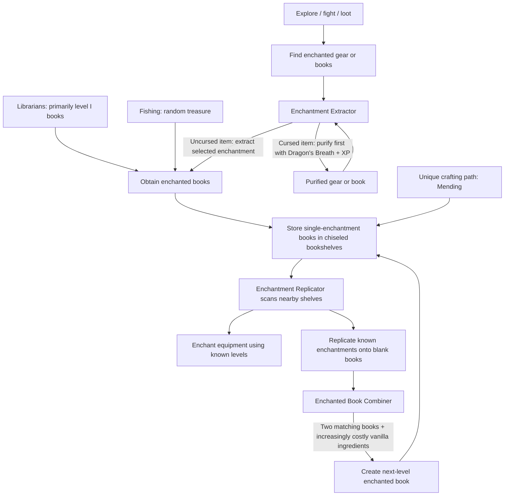

# Enchanting Overhaul — Design Specification

> **Status:** Gameplay design draft. **All 41 non-curse initiation catalysts are confirmed.** Full synthesis recipes, replication/extraction XP and lapis schedules, purification XP, and librarian level distribution are now **concrete proposed defaults awaiting playtesting**. Physical library boundaries, exact workstation crafting layouts, final GUI layouts, edge cases, and implementation specifics are deliberately deferred. **Replicator operation is one enchantment and one level per confirmation; its target remains in the workstation between applications. Manual input slots and the Combiner ingredient-inventory concept are specified below, but final UI visuals will be provided via screenshots.** Current enchantment checklist uses **Minecraft Java Edition 26.3** (including Lunge); implementation version/loader are not pinned.
>
> **Scope:** Replace vanilla enchanting progression using **vanilla enchantments and vanilla item ingredients**, with a small set of new functional blocks. This is not intended to be an RPG skill tree, a new magic system, or an Apotheosis-style expansion.

## 1. Vision

Vanilla enchanting can let players jump from unenchanted gear to near-perfect equipment very quickly. Random enchanting-table rolls and repetitive villager trade rerolls can feel frustrating, while lower enchantment levels often go unused.

This overhaul aims to:

1. **Make acquisition meaningful.** A newly discovered enchantment book represents lasting knowledge, not a one-time consumable upgrade.
2. **Make progress deterministic once knowledge is acquired.** Players choose exactly which known enchantment and level they want to apply.
3. **Make upgrading knowledge difficult, but using it reasonable.** High levels should require serious progression; fully researching the library should make replacing gear straightforward.
4. **Encourage gradual use.** Enchanting an iron sword with Sharpness I now must not financially punish a player who later upgrades it to II, III, IV, and V.
5. **Reward exploration and positive luck.** Finding a high-level book or enchanted item may legitimately skip research steps; grinding random rolls should not be required.
6. **Give existing vanilla content new relevance.** Brewing, lapis, ordinary biome resources, enchanted mob drops, structure loot, fishing, and librarians should all have useful roles.
7. **Feel like vanilla.** Use existing Minecraft items and enchantments. New content is primarily machinery/UI, not new currencies, skill trees, custom crafting components, or universal research-tier gates.

### Guiding rule

**Knowledge is expensive to advance, relatively cheap to use, and can be discovered early through exploration or luck.**

---

## 2. Terminology

- **Enchantment knowledge / blueprint:** A physical enchanted book stored in a **chiseled bookshelf**. A book for an enchantment at level `L` makes that enchantment available at **all levels from I through L** while the book is in the connected library.
- **Library:** The collection of chiseled bookshelves within range of an Enchantment Replicator. It is physically built and shared by all players who can access it.
- **Replication:** Applying an enchantment already represented in the library to an eligible item or blank book. The selected level cannot exceed the library's highest available level.
- **Initiation catalyst:** A **fixed thematic vanilla item** for each enchantment, consumed only when that enchantment is newly introduced to a particular target item or book, regardless of the chosen level.
- **Synthesis / combination:** Combining two enchanted books with the **same enchantment and same level**, plus increasingly demanding vanilla materials, to produce the book for the next level.
- **Extraction:** Selecting and removing **one beneficial enchantment per operation** from enchanted equipment or a multi-enchantment book, converting it into a separate enchanted book. The source retains any other enchantments. Extraction costs level-scaled raw XP (proposed: 55/160/280/441/679 points for levels I–V); cursed sources must be purified first.
- **Purification:** A special Enchantment Extractor operation that removes the curses on one item or enchanted book, preserving beneficial enchantments and other item data. Proposed cost: **1 Dragon's Breath + 315 raw XP** (equivalent to level 0 → 15).

### Three new functional blocks

| Block | Core purpose |
| --- | --- |
| **Enchantment Extractor** | Removes **one selected beneficial enchantment at a time** for XP; also purifies cursed gear/books using **1 Dragon's Breath + proposed 315 raw XP**. |
| **Enchantment Replicator** | Reads nearby chiseled bookshelves and deterministically applies known enchantments to equipment or blank books. |
| **Enchanted Book Combiner** *(working name)* | Combines two equal-level, same-type enchanted books using a level-specific synthesis recipe. |

Chiseled bookshelves themselves remain **vanilla blocks** and constitute the library; they are not a fourth custom block.

### Workstation crafting ingredients — Option A selected, precise recipes pending

The following **vanilla ingredient sets are selected**. They specify the components to use, **not yet the required quantities or shaped crafting-grid arrangements**:

| Block | Selected crafting ingredients | Open recipe details |
| --- | --- | --- |
| **Enchantment Extractor** | Grindstone + Copper Ingots + Amethyst Shard | Copper/amethyst quantities; exact pattern |
| **Enchantment Replicator** | Enchanting Table + Amethyst Shards | Amethyst quantity; exact pattern |
| **Enchanted Book Combiner** | Anvil + Amethyst Shards + Bookshelf | Amethyst quantity; exact pattern |

The vanilla Enchanting Table is a **crafting component** for the Replicator, not a way to bypass the replacement enchanting system. The Anvil is a crafting component for the Combiner, but its vanilla enchantment-merging/application operations remain disabled.

---

## 3. Complete player progression loop



Typical experience:

1. Find or trade for a low-level book, or find gear that already has an enchantment.
2. If the loot is cursed, first purify it at the Extractor using **1 Dragon's Breath + 315 raw XP** (proposed). Otherwise (or afterward), choose a beneficial enchantment to extract into its own book, paying **55–679 raw XP** according to its level. Repeat for any other enchantments you want.
3. Put the book in a chiseled bookshelf near a replicator. This is now shared, reusable knowledge **for as long as the book is stored there**.
4. Replicate that enchantment onto a real tool/weapon/armor piece, or onto a blank book to prepare for upgrading.
5. To unlock the next level, combine two matching books and pay the considerably more expensive synthesis ingredients.
6. Store the upgraded book in the library. The replicator now offers the upgraded level and all lower levels.
7. Repeat over time. Lucky discoveries of advanced loot may jump ahead in this process.
8. Once the library is complete, the remaining cost of enchanting replacement equipment should be modest relative to the effort invested in research.

**There are no random enchanting-table rolls and no requirement to research every preceding level if a higher-level book is found.**

---

## 4. Sources of enchantment knowledge

### 4.1 Extraction / exploration — primary early-game path

Keep existing enchanted equipment and book loot valuable:

- Naturally found enchanted books from structures and other existing loot sources.
- Enchanted gear from loot chests, mob drops, and other normal gameplay sources.
- Any legitimately obtained high-level enchantment book or enchanted item is valid knowledge, even if it lets the player skip multiple levels.
- The Extractor takes **one selected enchantment at a time** from equipment, yielding a single enchanted book; the original equipment retains every other enchantment.
- Repeat the operation if you want additional enchantments from the same item. You can instead leave useful enchantments on the equipment.
- Multi-enchantment books can likewise be separated **one selected beneficial enchantment at a time**; the original book keeps its remaining enchantments. A book already holding a single beneficial enchantment needs no splitting.
- **Cursed gear or books must be purified before beneficial enchantments can be extracted or used as clean library blueprints.** Purification deliberately makes cursed high-level discoveries harder to turn into permanent knowledge; it does not change vanilla loot probabilities.
- Extraction has a **level-scaled raw XP fee**: I = **55**, II = **160**, III = **280**, IV = **441**, V = **679** points. **XP is the only extraction resource** (no lapis/catalyst). Values are proposed defaults for playtesting, with V matching the raw XP required to go from level 0 to 22.
- The cost is paid for each extraction operation; selecting one enchantment must not modify other enchantments or unrelated item properties.
- High-level loot must remain worth extracting: don't let its extraction fee approach the cost of synthesizing that level.

Loot-based leaps are a *feature*, not an exploit. A Sharpness IV discovery should feel exciting, even before the player has synthesized Sharpness III.

### 4.2 Villagers — dependable basic discovery, not endgame bypass

- **Proposed librarian book levels:** **90% level I**, **10% level II** for otherwise eligible enchantments with a natural maximum of at least II. Enchantments capped at level I always trade at I. This is a starting distribution, not a new universal loot rule.
- Librarians do **not** offer high-level/max-tier books that would bypass the main synthesis progression.
- Villagers remain useful for filling gaps in a library and finding specific *types* of enchantment.
- Keep **vanilla-style emerald book trade pricing** (including existing trade-related price effects), with book level restricted as above; do not invent an additional trade currency. Keep normal vanilla trade eligibility rules for treasure/structure-exclusive enchants; exclude Mending. Exact trade-generation hooks are an implementation matter.

### 4.3 Fishing — optional gamble

- Enchanted-book fishing remains a luck-based alternative source of discoveries.
- Fishing is **not mandatory** for completing ordinary enchanting progression.
- **Keep vanilla enchanted-book catch rates and ordinary loot frequency unchanged.** Remove Mending from generated eligible outcomes as already specified, without artificially changing the overall enchanted-book drop opportunity; randomness should reward players, not gate required progress.

### 4.4 High-level special loot

- Keep the excitement and identity of finding valuable enchantments in late-game or dangerous loot, including Ancient Cities and End Cities where relevant.
- Do **not** impose a generic library research-tier gate on legitimately discovered high-level books.
- Other vanilla treasure enchantments remain part of the normal acquisition ecosystem unless a specific change is later agreed.

### 4.5 Mending — the one intentional acquisition exception

- **Mending is initially obtainable only through a dedicated deterministic crafting recipe**, made from vanilla items.
- Remove all other initial Mending sources: librarian trades, fishing, generated enchanted books, generated enchanted items, and other normal loot routes.
- Once crafted, Mending becomes a library blueprint like other enchantments.
- Replicating Mending remains **more expensive than replicating typical enchantments**, but should not make routine endgame gear replacement unreasonable.
- **Selected initial crafting concept (Option A):** **Nether Star + Ghast Tear + Golden Apple + Book** → Mending enchanted book. This is a **confirmed ingredient set**, not a finalized recipe: amounts, crafting grid/station, and any XP requirement remain TBD.
- **Selected Mending initiation catalyst:** **Ghast Tear**, charged each time Mending is first introduced to a target item/book. **Proposed special replication:** **240 raw XP + 18 lapis** for Mending I, plus the Ghast Tear; no higher levels exist.
- Using a Nether Star makes the *initial creation* a Wither-related late-game milestone; it does **not** require another Nether Star for ordinary Mending replication.
- **No random mutation/jackpot path for Mending is currently part of the agreed design.**

---

## 5. Physical library: chiseled bookshelves

**Hard requirement:** The Replicator must automatically detect eligible chiseled bookshelves nearby and display their available enchantments. Players must **not** manually move books into a menu merely to select an enchantment.

Rules:

- Each slot holds an actual enchanted book; physical storage defines available knowledge.
- **One enchantment per stored book** is the canonical format. If needed, use the Extractor repeatedly to separate a multi-enchantment book, one enchantment per operation.
- For a given enchantment, the **highest stored level** determines what the connected replicator offers. All lower levels are implicitly available, even if not stored individually.
- Example: storing Sharpness IV permits choosing Sharpness I, II, III, or IV.
- Multiple copies or lower-level books may coexist; they do not increase the highest available level.
- The library is **shared physically in multiplayer**: any authorized player using that setup sees the same available knowledge.
- It is not a permanent account-wide unlock: removing the only book holding an enchantment/level removes that knowledge from the local library until returned.
- Books found through loot, trades, extraction, and synthesis work as blueprints once stored, **provided they are not cursed**. Cursed books must first be purified by the Extractor; curses are not valid replicable library knowledge.

**Proposed, not locked:** A detection radius of roughly **4–6 blocks** with freedom to build creative bookshelf arrangements; exact range, wall/obstruction behavior, and whether connected shelves form one network still need decisions.

### Replicator interface requirements

- Show all available enchantments discovered from nearby shelves, **with a searchable/filterable list**.
- Show every unlocked level of each enchantment and allow explicit level selection.
- Only offer levels available in the library; no random rolls.
- When an item is inserted, show only compatible enchantments and enforce vanilla incompatibility rules (e.g. Silk Touch versus Fortune).
- **Apply exactly one selected enchantment at one selected level per operation.** There is no multi-enchantment batching or multi-selection. The player can apply another enchantment immediately afterward as a separate operation.
- Clearly distinguish **new enchantments** (catalyst required) from **upgrades of existing ones** (no catalyst).
- Preview the exact catalysts, XP, and lapis before confirming.
- Support an eligible piece of equipment **or a blank/previously enchanted book** as the target. Single-enchantment books are the standard output for the library/combiner.

### Replicator operation and material slots — confirmed

- The player **manually places one target item/book in the Replicator**, plus lapis lazuli in its **dedicated lapis slot** and (when introducing a new enchantment) the required ingredient in its **dedicated catalyst slot**.
- The player **selects one enchantment and one unlocked level**, confirms the operation, and pays the displayed cost. **Only that single enchantment** is added or upgraded by that confirmation.
- **The target stays in the same input slot after a successful application.** The player does **not** have to take out and reinsert their sword/book to enchant it further. Previously applied enchantments remain intact.
- For a **different new enchantment**, the player simply selects the next enchantment and level, **manually replaces/supplies the new initiation catalyst** in the catalyst slot, ensures enough lapis remains in its slot, and confirms again. Repeat one enchantment at a time until finished.
- **Do not automatically withdraw lapis or catalysts from the player's inventory.** Both resources must be manually deposited in their dedicated workstation slots; consume only the quantity needed for the chosen operation. XP comes from the player.
- Upgrading the level of an enchantment **already present on the target** requires **no initiation catalyst**, only the cumulative XP/lapis difference. The catalyst slot may remain empty for that operation.
- The available selections update for the inserted target type. Only applicable and mutually compatible enchantments may be selected; incompatible enchantments already on the target block applying the selected enchantment until removed (e.g. via the Extractor). The exact hidden/disabled presentation is deferred.
- Preview the exact **single-operation** catalyst, XP, and lapis cost before confirming. Each operation is server-authoritative and atomic, **modifies the enchantments on the item in place**, and leaves the item in its input slot if successful. Insufficient resources or incompatibility must leave the item and payments unchanged.
- **Multi-enchantment batching is explicitly not supported.** The single catalyst slot is sufficient because only one enchantment is applied per confirmation.
- The **functional interaction** above is a hard requirement; **exact GUI layout, widget placement, artwork, and screenshots are deferred** to the user's later direction.

---

## 6. Replication: deterministic, reasonably affordable, progressively credited

Each **single-enchantment replication operation** can require three resources:

1. **Fixed initiation catalyst** — a thematic vanilla item, the **same catalyst regardless of enchantment level**, and paid only if the target does not already have that enchantment.
2. **XP** — a cumulative cost based on the chosen level; upgrading an existing enchantment costs only the difference.
3. **Lapis lazuli** — a small universal cumulative material cost, also charged only for the difference when upgrading.

**Hard requirement:** Applying the same level of an enchantment to an otherwise equivalent **blank book or eligible equipment must have the same cost**. Books must not provide a cheaper workaround than swords (or vice versa).

### Cost model

Let `E[L]` be the cumulative XP cost of applying enchantment level `L` and `P[L]` its cumulative lapis cost. Define `E[0] = P[0] = 0`.

For target with existing level `a`, requesting level `b` (`b > a`):

```text
XP charged    = E[b] - E[a]
Lapis charged = P[b] - P[a]
Catalyst      = 1 fixed thematic catalyst if a == 0, otherwise 0
```

Properties:

- `None -> V` costs exactly the same total resources as `None -> I -> II -> III -> IV -> V`, assuming the same item and no extraction/reapplication in between.
- `I -> III` costs the sum of the incremental `I -> II` and `II -> III` costs, **not** the full `None -> III` cost.
- Applying Smite V directly to a fresh sword consumes **one Smite catalyst**; applying Smite I and later upgrading to V also consumes **one total Smite catalyst**.
- Upgrading existing enchantments never recharges their initiation catalyst.
- Applying several distinct enchantments takes **several separate operations**, each with its own independently charged cost. Their total XP/lapis expenditure is the sum across those operations; each newly introduced enchantment has its **own** catalyst. The target remains inserted throughout.
- Applying a lower or equal level to an already-enchanted item should not silently downgrade or waste resources; explicit replacement/downgrade rules are TBD.

**Cost unit:** Charge **raw experience points**, not discrete XP levels (the latter have nonlinear point costs). Numerical amounts are **proposed playtest defaults**, rather than permanently fixed tuning.

### Proposed replication XP/lapis schedule — numerical baseline

The XP and lapis tables below apply **uniformly to all ordinary non-curse enchantments** by level. Broadly powerful enchants are made *harder to research through their synthesis recipes*, rather than imposing a second opaque per-enchant multiplier on routine replication. This preserves simple, predictable costs after completing the library.

| Requested level | Cumulative **raw XP** | Cumulative **lapis lazuli** | Additional cost on prior level (XP / lapis) |
| --- | ---: | ---: | ---: |
| I | 20 | 2 | 20 / 2 (from absent) |
| II | 55 | 5 | 35 / 3 |
| III | 110 | 9 | 55 / 4 |
| IV | 180 | 14 | 70 / 5 |
| V | 275 | 20 | 95 / 6 |
| **Mending I — special** | **240** | **18** | **240 / 18**, plus Ghast Tear on fresh target |

- These are **cumulative**, not per-level charges. Example: Smite I → III consumes **90 raw XP and 7 lapis** with **no second catalyst**; absent → III consumes **110 raw XP + 9 lapis + 1 Splash Potion of Healing**.
- Each brand-new enchantment on a *book or piece of equipment* consumes its own **fixed Option A initiation catalyst**, even if the chosen level is V. A subsequent level upgrade on the same item consumes no additional catalyst.
- This table is deliberately **not multiplied by the enchantment's power category**. The higher research burden for Protection/Sharpness/Power/Efficiency comes from the level-up synthesis materials, not ongoing punitive replication costs.
- Book replication is **not free**: creating two level-IV books for synthesis consumes the initiation catalyst, XP, and lapis **twice**, plus the synthesis recipe ingredients. This is an intended secondary resource sink.
- **Illustrative max-set budget:** Helmet, chestplate, leggings, boots, sword and Fortune pickaxe, all with commonly chosen max compatible enchantments and **Mending on each**, cost approximately **356 lapis + 4,560 raw XP** to enchant from scratch (excluding catalysts). This is about **5 stacks + 36 lapis**, considerably beyond vanilla's tiny lapis expense. Exact loadout and budget appear in the balance appendix below.
- Adjust numerical values after survival testing. The permanent reward remains the expensive **research** already completed: no extra synthesis payments when recreating a set.

### Initiation catalyst design — **confirmed full list**

- Exactly **one fixed vanilla initiation catalyst per enchantment**, regardless of its level; the catalyst is charged only when applying that enchantment to an item/book which does not already have it.
- **Option A was selected for every enchantment** in the 41-enchantment non-curse Java Edition 26.3 set. These are now the intended default catalysts, not merely illustrative possibilities.
- Several choices intentionally require brewing, special biomes, or later-game resources **even at level I**. This is an accepted gameplay tradeoff; do **not** silently substitute easier alternatives in implementation.
- Curses have **no catalyst**: they cannot be replicated. Selected Mending catalyst is **Ghast Tear**, with higher XP/lapis replication costs than an ordinary level-I enchantment.
- Each row specifies **one catalyst item per new application**, regardless of selected level. For potions, the named potion variant is required; exact empty-bottle/container return behavior is TBD.

#### Armor enchantments (12)

| Enchantment | Max level | **Selected initiation catalyst** |
| --- | :---: | --- |
| Protection | IV | Shield |
| Fire Protection | IV | Magma Cream |
| Blast Protection | IV | Obsidian |
| Projectile Protection | IV | Shield |
| Thorns | III | Cactus |
| Respiration | III | Nautilus Shell |
| Aqua Affinity | I | Prismarine Shard |
| Feather Falling | IV | Feather |
| Depth Strider | III | Potion of Swiftness |
| Frost Walker | II | Packed Ice |
| Soul Speed | III | Soul Soil |
| Swift Sneak | III | Sculk |

#### Melee weapon enchantments (7)

| Enchantment | Max level | **Selected initiation catalyst** |
| --- | :---: | --- |
| Sharpness | V | Flint |
| Smite | V | Splash Potion of Healing |
| Bane of Arthropods | V | Potion of Infestation |
| Knockback | II | Piston |
| Fire Aspect | II | Blaze Powder |
| Looting | III | Rabbit's Foot |
| Sweeping Edge | III | Wind Charge |

#### Mace enchantments (3)

| Enchantment | Max level | **Selected initiation catalyst** |
| --- | :---: | --- |
| Density | V | Iron Block |
| Breach | IV | Iron Pickaxe |
| Wind Burst | III | Wind Charge |

#### Tools and durability (5)

| Enchantment | Max level | **Selected initiation catalyst** |
| --- | :---: | --- |
| Efficiency | V | Redstone Dust |
| Silk Touch | I | Honeycomb |
| Fortune | III | Emerald |
| Unbreaking | III | Obsidian |
| Mending | I | **Ghast Tear** (higher XP/lapis fees; initial unlock must be crafted) |

#### Ranged weapons (7)

| Enchantment | Max level | **Selected initiation catalyst** |
| --- | :---: | --- |
| Power | V | Gunpowder |
| Punch | II | Slimeball |
| Flame | I | Blaze Powder |
| Infinity | I | Ender Pearl |
| Quick Charge | III | Redstone Dust |
| Multishot | I | Firework Rocket |
| Piercing | IV | Pointed Dripstone |

#### Trident, fishing rod and spear (7)

| Enchantment | Max level | **Selected initiation catalyst** |
| --- | :---: | --- |
| Loyalty | III | Lead |
| Riptide | III | Nautilus Shell |
| Channeling | I | Lightning Rod |
| Impaling | V | Prismarine Shard |
| Luck of the Sea | III | Nautilus Shell |
| Lure | III | Tropical Fish |
| Lunge | III | Wind Charge |

**Coverage:** 12 + 7 + 3 + 5 + 7 + 7 = **41 non-curse enchantments**. The remaining two vanilla enchantments are **Curse of Binding** and **Curse of Vanishing**, which cannot be replicated. Recheck registry contents when a newer target version is chosen.

### Progression and endgame feel

- Replication should be **noticeably cheaper and simpler than synthesis**, although not literally free.
- The initial catalyst makes applying a fresh enchantment meaningful; subsequent upgrades are cheaper because earlier XP/lapis spending is credited.
- Completing the library is its own reward: maxed-out replacement gear becomes *reasonably inexpensive* to reproduce.
- Mending is the deliberate relative exception; it should remain costlier to replicate, without ruining the endgame reward.

---

## 7. Synthesis: the expensive progression mechanism

The **Enchanted Book Combiner** upgrades knowledge, not equipment.

Input and result:

```text
Book: Enchantment X, level N
+ Book: Enchantment X, level N
+ required vanilla synthesis ingredients for X, N -> N+1
------------------------------------------------------
= Book: Enchantment X, level N+1
```

Rules:

- Inputs must contain the **same enchantment and same level**.
- The enchantment's maximum vanilla level is the ceiling (unless separately specified; **no extra enchantment levels are planned**).
- **Replicated enchanted books may be used as both synthesis inputs**. No distinction between naturally obtained books and replicated books is needed.
- The two input books and the synthesis ingredients are consumed; a new higher-level book is produced.
- Synthesized books can be placed in the library to unlock the result for unlimited **costed** replication.
- Materials should become **significantly more demanding with level**, with thematic variations by enchantment.
- Brewing and exploration items can appear in these recipes, as long as they are vanilla items.
- Higher-level synthesis must be **deterministic**; no success-rate gambling or repeated rerolls.
- A player who finds a higher-level book through loot can add it immediately without having synthesized preceding levels.
- **No item + item, book + gear, or book + book enchantment upgrades via anvil.**

### Important economic interpretation

Because a library can replicate books, the *second matching book* is not meant to be the major obstacle. The meaningful step is the **additional synthesis recipe**. Requiring two matching books preserves a recognizable Minecraft-style upgrading interaction without forcing the player to find 16 random level-I books.

To upgrade a stored Sharpness III library to Sharpness IV, the player can replicate **two Sharpness III books**, provide the Sharpness III -> IV materials, combine them, and place Sharpness IV into a shelf. The original stored Sharpness III book need not be removed or consumed.

**Proposed synthesis fee: no additional XP or lapis at the Combiner.** The two input books must still have been obtained/replicated, incurring their own replication fees. The high-value **thematic ingredients** listed below are the expensive knowledge-progression step. Prices and ingredients are initial *recommendations to playtest*, not previously approved hard requirements.

### Combiner ingredient storage — provisional UI direction

- The two matching enchanted books are supplied to the Combiner as distinct recipe inputs.
- Rather than automatically consuming synthesis materials from the player inventory, the Combiner should have a **small internal ingredient inventory** into which the player deposits vanilla synthesis items.
- **Approximately 20 inventory slots** is the current concept, **not a locked capacity or finalized GUI**. The Combiner consumes the required materials from that inventory when a valid synthesis is confirmed.
- The workstation should validate availability, show the required ingredient counts, and atomically consume only the correct amount; leave surplus ingredients in its storage.
- The exact slot count, how the book inputs and output are arranged, and the on-screen material/recipe presentation are deferred to user-provided screenshots. **Do not automatically source ingredients from the player inventory.**

### Full proposed synthesis recipes — 41-enchantment coverage

Each populated cell means **two enchanted books of that enchantment at the starting level + exactly the listed vanilla ingredients → one book at the next level**. All listed materials are consumed. For instance, Sharpness III → IV requires **two Sharpness III books + 1 Diamond + 4 Nether Quartz**. A dash (—) means the upgrade does not exist for that enchantment.

- Materials use their **vanilla variants**. Potion names refer to exact potion effects (e.g. **Splash Potion of Healing II**); when no level or duration is specified, use the standard base potion variant. Use the unenchanted standard item when an equipment item (e.g. Iron Pickaxe) appears in a recipe.
- Each recipe is **independent**; there is no global Nether/End research tier. Some named ingredients intentionally require visiting certain biomes, Nether structures, Trial Chambers, ocean monuments, Ancient Cities, etc. This follows the stated exploration goal.
- **General-purpose, powerful research is costlier.** Sharpness, Protection, Power, Efficiency, Fortune, Looting and Unbreaking generally demand more than specialized Smite, Bane of Arthropods or Projectile Protection. The requirements are thematic rather than mathematically identical at every level.
- These are **ingredient counts for the Combiner**, not shaped 3×3 crafting layouts. A Combiner UI supporting multiple ingredient types/counts will be designed later.

| Enchantment | Max | I → II | II → III | III → IV | IV → V |
|---|:---:|---|---|---|---|
| Protection | IV | 4 Leather + 2 Iron Ingots | 1 Shield + 4 Obsidian | 2 Diamonds + 1 Potion of the Turtle Master + 2 Obsidian | — |
| Fire Protection | IV | 4 Magma Cream + 2 Nether Brick items | 2 Obsidian + 1 Potion of Fire Resistance | 1 Golden Apple + 1 Potion of Fire Resistance + 2 Blaze Rods | — |
| Blast Protection | IV | 8 Gunpowder + 2 Iron Ingots | 2 TNT + 4 Obsidian | 1 Blast Furnace + 2 Diamonds + 1 TNT | — |
| Projectile Protection | IV | 8 Arrows + 2 Leather | 1 Shield + 4 String + 2 Iron Ingots | 1 Shield + 4 Amethyst Shards + 1 Diamond | — |
| Thorns | III | 8 Cactus + 4 Sweet Berries | 4 Pointed Dripstone + 1 Diamond + 4 Cactus | — | — |
| Respiration | III | 4 Kelp + 1 Pufferfish | 1 Potion of Water Breathing + 4 Prismarine Crystals + 1 Diamond | — | — |
| Aqua Affinity | I | — | — | — | — |
| Feather Falling | IV | 8 Feathers + 2 Slimeballs | 1 Hay Bale + 1 Phantom Membrane + 4 Wool | 1 Potion of Slow Falling + 2 Phantom Membranes + 1 Diamond | — |
| Depth Strider | III | 4 Sugar + 8 Kelp | 1 Nautilus Shell + 1 Potion of Swiftness II + 4 Prismarine Shards | — | — |
| Frost Walker | II | 4 Blue Ice + 1 Potion of Water Breathing + 1 Diamond | — | — | — |
| Soul Speed | III | 8 Soul Sand + 2 Soul Torches | 4 Soul Lanterns + 1 Ghast Tear + 1 Diamond | — | — |
| Swift Sneak | III | 4 Sculk + 8 Wool + 1 Sculk Sensor | 2 Echo Shards + 1 Sculk Shrieker + 1 Diamond | — | — |
| Sharpness | V | 2 Flint + 1 Iron Ingot | 4 Iron Ingots + 1 Amethyst Shard | 1 Diamond + 4 Nether Quartz | 1 Netherite Scrap + 1 Potion of Strength II |
| Smite | V | 1 Bone Block + 4 Rotten Flesh | 1 Soul Sand + 1 Gold Ingot | 1 Splash Potion of Healing + 1 Glistering Melon Slice | 1 Ghast Tear + 1 Splash Potion of Healing II + 1 Golden Apple |
| Bane of Arthropods | V | 4 Spider Eyes + 1 Brown Mushroom | 2 Fermented Spider Eyes + 8 String | 1 Potion of Infestation + 1 Diamond + 4 Cobwebs | 1 Potion of Infestation + 2 Fermented Spider Eyes + 4 Spider Eyes |
| Knockback | II | 4 Slimeballs + 2 Pistons + 4 Redstone Dust | — | — | — |
| Fire Aspect | II | 1 Blaze Rod + 1 Fire Charge + 1 Potion of Fire Resistance | — | — | — |
| Looting | III | 1 Gold Block + 1 Rabbit's Foot + 2 Emeralds | 1 Diamond + 2 Rabbit's Feet + 1 Golden Apple | — | — |
| Sweeping Edge | III | 1 Wind Charge + 4 Feathers + 2 Iron Ingots | 2 Breeze Rods + 1 Diamond + 4 Wind Charges | — | — |
| Density | V | 1 Iron Block + 4 Deepslate | 2 Iron Blocks + 4 Obsidian | 1 Diamond Block + 2 Amethyst Blocks | 1 Netherite Scrap + 4 Obsidian + 1 Wind Charge |
| Breach | IV | 1 Iron Pickaxe + 2 Copper Blocks | 2 Diamonds + 2 Iron Blocks | 1 Netherite Scrap + 1 Diamond Pickaxe | — |
| Wind Burst | III | 4 Wind Charges + 1 Breeze Rod | 4 Breeze Rods + 1 Ominous Bottle | — | — |
| Efficiency | V | 1 Copper Ingot + 2 Redstone Dust | 1 Piston + 1 Redstone Block | 1 Diamond + 2 Amethyst Shards | 1 Netherite Scrap + 1 Potion of Swiftness II |
| Silk Touch | I | — | — | — | — |
| Fortune | III | 1 Emerald Block + 1 Rabbit's Foot | 2 Diamonds + 1 Gold Block + 1 Rabbit's Foot | — | — |
| Unbreaking | III | 4 Obsidian + 2 Iron Blocks | 2 Diamonds + 1 Ancient Debris + 1 Obsidian | — | — |
| Mending | I | — | — | — | — |
| Power | V | 4 Flint + 8 Arrows | 1 Bow + 4 Gunpowder + 4 String | 1 Diamond + 1 Firework Star + 4 Amethyst Shards | 1 Netherite Scrap + 1 Firework Rocket + 1 Potion of Strength II |
| Punch | II | 4 Slimeballs + 2 Pistons + 4 Arrows | — | — | — |
| Flame | I | — | — | — | — |
| Infinity | I | — | — | — | — |
| Quick Charge | III | 1 Redstone Block + 1 Tripwire Hook + 2 Copper Ingots | 2 Redstone Blocks + 1 Crossbow + 1 Diamond | — | — |
| Multishot | I | — | — | — | — |
| Piercing | IV | 4 Pointed Dripstone + 8 Arrows | 1 Iron Block + 2 Amethyst Shards + 4 Pointed Dripstone | 1 Diamond + 1 Crossbow + 1 Iron Block | — |
| Loyalty | III | 2 Leads + 1 Compass | 1 Compass + 1 Ender Pearl + 2 Prismarine Crystals | — | — |
| Riptide | III | 8 Kelp + 4 Prismarine Shards | 1 Heart of the Sea + 1 Potion of Swiftness II | — | — |
| Channeling | I | — | — | — | — |
| Impaling | V | 4 Prismarine Shards + 8 Raw Cod | 2 Prismarine Crystals + 4 Pointed Dripstone | 1 Diamond + 1 Nautilus Shell + 2 Prismarine Crystals | 1 Heart of the Sea + 1 Diamond + 1 Potion of Water Breathing |
| Luck of the Sea | III | 1 Rabbit's Foot + 4 Raw Cod | 1 Heart of the Sea + 1 Emerald Block | — | — |
| Lure | III | 4 Tropical Fish + 8 String | 1 Pufferfish + 1 Nautilus Shell + 1 Potion of Water Breathing | — | — |
| Lunge | III | 4 Wind Charges + 4 Sugar | 2 Breeze Rods + 1 Potion of Swiftness II + 1 Diamond | — | — |

### Enchantments with no synthesis upgrade

**Aqua Affinity, Silk Touch, Mending, Flame, Infinity, Multishot, and Channeling** are naturally capped at **level I**, so there are no I → II recipes to invent for them. Their discovery, initiation catalysts, and (for Mending) special first-book crafting recipe carry their progression. Do **not** add artificial extra levels or a new research-tier system to compensate.

### Balancing notes to test before treating the recipes as final

- **Specialists should be viable earlier:** Smite IV/V and Bane IV/V avoid Netherite Scrap; Sharpness V uses it. Projectile Protection IV is less demanding than Protection IV.
- **Rare unlocks are paid once:** Heart of the Sea, Echo Shards, Netherite Scrap, Ancient Debris, and similar exploration-heavy ingredients appear in **synthesis only**, not on each use of the researched enchantment (unless a separate *confirmed catalyst* happens to be that item).
- **Multiple strong demands stack:** Completing all high-tier recipes may require substantial Netherite Scrap, rare exploration, and brewing. That's appropriate for a complete library, but a complete library should **not depend on repeating a one-off, nonrenewable material for every equipment replacement**.
- Some individual recipes may feel disproportionately hard in survival (notably Soul Speed, Swift Sneak, Wind Burst, Frost Walker, Riptide). They are **deliberate playtest candidates**, not hidden hard gates; revise quantities instead of redesigning the core system if needed.
- Potion catalysts and potion ingredients are consumed per operation. **Glass-bottle/container return handling is deferred to the edge-case/GUI discussion**, not silently decided here.

---

## 8. Enchantment Extractor

The Extractor salvages **one specific enchantment per operation**, rather than bulk-stripping an item. It is intended to turn loot into library knowledge without synthesis materials, while making a **lucky high-level extraction require meaningful XP**.

### Player interaction

1. Insert an enchanted equipment item or a book containing multiple enchantments.
2. The GUI lists the enchantments currently on that item and their levels.
3. Select **one** enchantment to remove. Preview the resulting book and the extraction XP cost.
4. Confirm. After successful payment, exactly that enchantment is removed and **one** corresponding enchanted book is produced.
5. The source item remains in the input slot with all other enchantments intact. Repeat only if desired.

### Gameplay purpose: reconfigure valuable equipment

Because only **one chosen enchantment** is removed, extraction is also a way to **reconfigure a treasured, otherwise maxed-out item**, rather than only salvage loot for the library. For example, a sword with **Smite V, Looting III, Unbreaking III, and Mending** can have **Smite V alone** extracted, leaving the other expensive enchantments intact. The player can then apply **Sharpness V** or **Bane of Arthropods V** through the Replicator if that level is in the library. They can later extract the replacement and switch back, paying the normal extraction and fresh-application costs each time.

This gives specialized, mutually exclusive damage enchantments a practical life beyond one-time weapon selection. **Do not allow incompatible damage enchantments to coexist**: switching must first remove the existing conflicting enchantment, then apply the replacement. The extracted book is a real item that can be kept or stored as knowledge; the other enchantments and the sword itself survive.

### Rules

- Equipment survives extraction; only the **selected** enchantment is removed. Preserve its other enchantments, durability, name, custom components, and all non-enchantment properties.
- On **multi-enchantment books**, the selected beneficial enchantment is transferred into a new single-enchantment book; the original book retains the other enchantments. If just one beneficial enchantment remains and the book is uncursed, that book is already suitable for the library and needs no further splitting.
- **One operation yields exactly one enchanted book.** There is no automatic conversion of all enchantments into multiple outputs.
- Extraction is **not free**: pay the **raw-XP fee from the table below** based on the **selected enchantment's existing level**, even if its natural maximum is lower than V. These are proposed initial values; higher-level discoveries require more investment to transfer into the library.
- **XP is the only extraction fee.** No lapis, initiation catalyst, or enchantment-specific ingredient. Extraction is a **salvage route for new knowledge**, and need not be numerically cheaper in XP alone than applying an enchantment you already know. It must remain substantially easier than synthesizing a high level from scratch.
| Extracted level | **Raw XP cost** | XP equivalent starting from level 0 |
| --- | ---: | --- |
| I | **55** | Level 5 |
| II | **160** | Level 10 |
| III | **280** | Level 14 |
| IV | **441** | Level 18 |
| V | **679** | Level 22 |

For example, a player with **exactly level 22 and zero progress** spends **679 XP** to extract Sharpness V and lands at **level 0**. From a higher starting level, the same **679 raw XP** is deducted—it does *not* forcibly set the player to level 0, nor does it always subtract 22 levels. These values use Minecraft's real nonlinear XP curve; see the reference note in the balancing appendix.

- Each extracted enchantment is charged **separately**, since each operation handles one enchantment. Other enchantments on the item incur no cost until selected.
- Items already enchanted by the Replicator can be extracted too. **No provenance tags, replicated-item blacklist, or origin restrictions are necessary.**
- An extracted book may enter the library or be used as a valid book in synthesis, just like a looted book.
- An item stripped of an enchantment and later receiving that enchantment again is a **fresh target** and pays the initiation catalyst again. Previous replication costs and extraction XP are not refunded.
- Prevent duplication: transfer/removal of the selected enchantment and XP payment are **atomic**, server-authoritative operations, not a copy.
- If the output cannot hold the **single resulting book**, or the player lacks sufficient XP, leave the source item, its enchantments, and the player's resources **entirely unchanged**.
- A single-enchantment book does not need extraction because it is already a valid blueprint; avoid offering a pointless book-to-identical-book conversion.
### Curses and purification — confirmed

- **Curses retain their vanilla behavior** on equipped or carried items. Cursed equipment can still be used normally.
- **While any curse remains, standard beneficial-enchantment extraction is blocked.** The Extractor cannot selectively take out valuable enchantments around a curse.
- The Extractor has a separate **Purify** operation for cursed equipment and enchanted books. Purification removes **all curses on the target item** and preserves every beneficial enchantment, the base item, durability, name, and other non-enchantment properties.
- **Proposed purification cost per item:** **1 Dragon's Breath + 315 raw XP**, equivalent to the total XP from **level 0 → 15**. No lapis fee. All curses on one item are removed together for one fee. The Dragon's Breath ingredient is confirmed; the XP number is the proposed tuning default.
- A cursed enchanted book must also be purified before its beneficial enchantments can be used as **clean library blueprints** or extracted into clean individual books.
- Curses cannot be replicated or synthesized through the normal enchanting progression. They are not selectable library enchantments and do not become clean blueprints without purification.
- Dragon's Breath makes curse removal an intentional **Ender Dragon encounter gate** (breath can be collected during the fight; defeating the dragon is not required). Early cursed loot remains usable with its curse, but its enchantments cannot immediately be salvaged for library progression.
- Leave vanilla curse generation/loot probabilities unchanged for now. In particular, the often-cited **~35.9% Ancient City enchanted-book chest loot chance is not a 35.9% curse chance**; it must not be documented or balanced as such.
- Purification must be **server-authoritative and atomic**: if the player lacks XP, Dragon's Breath, or a valid input, do not consume resources or alter the item.
- **Vanilla loopholes:** Grindstones and any other cleansing/extraction routes must not bypass curse restrictions. Keep Curse of Binding's vanilla worn-equipment restrictions intact.


### Why extraction does not break progression

Extraction can recover only an **existing enchantment at its existing level**. Neither replicated gear nor repeatedly transferring an enchantment between gear and books creates higher-level knowledge. A higher level still comes from a lucky discovery or paying a valid synthesis recipe. Charging XP introduces a small salvage/transfer cost without undermining this rule.

---

## 9. Vanilla mechanics and compatibility

| Existing mechanic | Intended behavior |
| --- | --- |
| **Vanilla enchanting table** | Replaced/superseded by Enchantment Replicator; random enchantment rolls are not part of the new system. Exact handling of placed tables and old worlds TBD. |
| **Chiseled bookshelves** | Store physical blueprints used by nearby replicators. |
| **Anvil** | Can still rename and perform appropriate ordinary repair, but **cannot** apply, merge, or upgrade enchantments. No vanilla prior-work penalty for replication/synthesis. |
| **Smithing table** | Diamond-to-netherite upgrades preserve existing enchantments as usual. |
| **Grindstone** | **Keep vanilla disenchants and small XP refunds for now**, with vanilla curses retained; it must not transfer beneficial enchantments into blueprint books, cleanse curses, or create profitable XP loops from replicated items. Regression-test refund bounds before release. |
| **Librarians** | Primarily level-I enchanted-book trades; maybe some level II, no high-tier books. No Mending trades. |
| **Fishing** | Retains random enchanted-book discovery, excluding Mending. |
| **Generated loot and mob gear** | Existing relevant enchanted loot remains a discovery source, including high-level surprises; exclude Mending. |
| **Treasure enchantments** | Preserve vanilla identity/acquisition wherever possible; Mending is the sole specifically redesigned acquisition exception. |
| **Enchantment compatibility** | Enforce vanilla equipment applicability and mutually exclusive enchantment rules. |
| **Curse enchantments** | Retain vanilla effects and vanilla loot generation. Cursed gear/books must first be purified in the Extractor (**1 Dragon's Breath + proposed 315 raw XP**) before beneficial extraction or clean library use. Curses are not replicated or synthesized. |

### Balancing considerations

- The confirmed thematic catalysts can make fresh equipment expensive, including brewing or unusual biomes, **by user choice**. Evaluate actual new-set friction during balancing rather than silently substituting earlier easier candidate items. Reserve truly irreplaceable resources for one-time synthesis or initial Mending crafting where possible.
- **Level-scaled extraction deliberately limits instant use of lucky high-level enchanted gear as permanent knowledge**: Sharpness V extraction costs 679 raw XP. The player can still *use* the found equipment immediately; direct high-level books can go into an uncursed library without extraction. Purification remains an additional late-game exception for cursed loot.
- An XP farm should help players use unlocked knowledge but should not, by itself, replace the need for synthesis ingredients.
- **Keep vanilla Grindstone behavior as the starting policy.** Its small XP refunds are *expected* to be below replication XP inputs, but this must be verified across every enchantment and level rather than assumed. If an exploit appears, apply a narrow refund fix; do not redesign the Grindstone preemptively.
- Keep lower levels useful through early availability and **full incremental cost credit**; players may also freely wait, but waiting shouldn't save resources.
- Do not require a uniform Nether/End gate for *every* enchantment level. Let individual vanilla material recipes establish a sensible curve.

---

## 10. Important gameplay examples

### Example A — Early enchanted mob drop

1. A skeleton drops an enchanted bow.
2. The player selects one enchantment in the Extractor, pays its level-scaled XP cost, and receives its book. The bow retains any other enchantments. They can extract additional enchantments later.
3. The player stores the book in a chiseled bookshelf.
4. The Replicator now offers that enchantment up to the discovered level.
5. The player pays its catalyst once to apply it to a bow, then only differential XP/lapis on later upgrades.

### Example B — Gradual progression versus waiting

A player first applies Smite I to a sword and later obtains Smite III knowledge.

- The Replicator upgrades the sword directly from I to III.
- The player does **not** pay another initiation catalyst.
- The player pays `110 - 20 = 90 raw XP` and `9 - 2 = 7 lapis`.
- Total cost over time equals applying Smite III to that sword directly when it was unenchanted.

### Example C — Advancing the library

1. The library contains Smite III.
2. The player replicates two Smite III books. Each blank book pays the normal book replication costs, including a catalyst.
3. The player puts both books and the required, harder vanilla synthesis ingredients in the Combiner.
4. The Combiner produces Smite IV.
5. The player stores it. The library now permits Smite I, II, III, and IV without any more synthesis for those levels.

### Example D — Lucky advanced loot

A player discovers a Sharpness IV book in late-game loot without having synthesized Sharpness II or III. They can put it into the library immediately and reproduce levels I–IV using normal replication costs. This is an **intended shortcut and exploration reward**.

### Example E — Cursed advanced loot

1. A player discovers gear with Sharpness IV and Curse of Vanishing before reaching the End.
2. The gear can be used normally with the curse, but the Extractor **blocks extraction** of Sharpness IV until the curse is removed.
3. After obtaining Dragon's Breath, the player chooses **Purify**, spends **1 Dragon's Breath + 315 raw XP**, and keeps the gear and its Sharpness IV enchantment without the curse.
4. The player may then extract Sharpness IV through the usual **separate, level-scaled XP extraction operation** and add the resulting book to the library.
5. A cursed enchanted book follows the same purification prerequisite before it can serve as a clean library blueprint.

### Example F — Changing one sword between Smite, Sharpness, and Bane

1. A sword already has **Smite V, Looting III, Unbreaking III, and Mending**.
2. The player extracts **only Smite V**, paying the proposed level-V extraction fee. The sword keeps Looting, Unbreaking, and Mending. The extracted Smite V book is preserved.
3. With Sharpness V available in the nearby library, the player inserts that sword into the Replicator and supplies **the Sharpness initiation catalyst and lapis in their dedicated slots**, plus the normal XP cost for a newly applied Sharpness V.
4. The resulting sword has Sharpness V and the same other enchantments. To switch again to Bane or back to Smite, the player removes the current conflicting enchantment through the Extractor first.
5. No illegal combinations, free catalyst refunds, or repeated re-research of the unchanged enchantments occur. This makes a fully developed sword adaptable to different encounters.

### Example G — Fully researched multiplayer library

A group has researched most enchantments and built a large shared library. Any member with access can quickly create replacement max-level gear from their available blueprints, providing confirmed catalysts, the proposed XP/lapis table, and the higher **Mending I = 240 XP + 18 lapis** fee. The rare effort was in **building the library**, not in every subsequent repair or replacement.

---

## 11. Implementation architecture (version/loader agnostic)

These are proposed implementation boundaries, **not claims that specific APIs already exist**.

### Data model

- **Enchantment key:** Vanilla enchantment identifier; use the registered enchantment's natural maximum level and compatibility rules.
- **Library snapshot:** Effective highest level per enchantment, computed from enchanted books found in nearby chiseled bookshelf slots.
- **Replication definition:** The 41 fixed initiation catalysts enumerated in Section 6 (data-driven), plus cumulative XP/lapis cost functions by level; Mending uses the confirmed Ghast Tear catalyst and can override the cost scale.
- **Extraction definition:** Raw XP fees **[55,160,280,441,679] for I–V**, charged for a single selected beneficial enchantment from an uncursed source (proposed initial values).
- **Purification definition:** Distinct Extractor operation, costing **1 Dragon's Breath + proposed 315 raw XP**, removing all curses while preserving beneficial enchantments and unrelated state. Vanilla curse effects and loot probabilities are unchanged.
- **Synthesis recipe:** **The full 85 candidate upgrades in Section 7**: enchantment key + input level + two matching input books + exact vanilla ingredient/count requirements -> next-level book. No additional Combiner XP/lapis fee proposed.
- **Mending acquisition recipe:** Deterministic initial recipe using **Nether Star + Ghast Tear + Golden Apple + Book**, with exact quantities/grid/station TBD; no external acquisition sources.

### Functional subsystems

1. **Library discovery:** Nearby-shelf scan, duplicate resolution (highest level wins), dynamic refresh when a bookshelf or book changes, shared server-side state.
2. **Replication validation:** Validate shelf knowledge, item-type applicability, compatibility against enchantments already on the target, the **single selected enchantment and level**, its existing level, XP, and lapis/catalyst **present in the dedicated Replicator slots**; never implicitly withdraw from the player inventory.
3. **Replication transaction:** For **one selected enchantment and level per confirmation**, atomically consume its lapis and (if needed) catalyst from the **workstation slots** and XP from the player, then apply or upgrade only that enchantment. **Keep the same item in the input slot afterward** so the player can change the selection/catalyst and repeat. Preserve other enchantments and apply cumulative upgrade credits. **No batching.**
4. **Extraction and purification transactions:** Reject extraction if **any curse** remains; otherwise validate the selected beneficial enchantment, XP and output space and atomically transfer it into one book. For purification, validate Dragon's Breath and XP, consume them atomically, remove curses, and preserve all beneficial enchantments and other item data.
5. **Synthesis transaction:** Match the two book inputs by enchantment type/level, check the **Combiner internal ingredient inventory** (around 20 slots tentatively), atomically consume recipe quantities from that inventory, and produce one next-level book. Never implicitly take ingredients from the player inventory.
6. **Acquisition controls:** Modify villager book trades, remove Mending from other sources, preserve other loot/fishing opportunities, and intercept legacy enchanting/anvil behavior.
7. **Client UI:** Search/filter enchantments, select **one enchantment and level at a time**, enforce item-specific applicability and incompatibilities, preview the cost for that one application, and keep the item inserted for consecutive operations. Replicator has dedicated target/lapis/catalyst slots; Combiner has book inputs/ingredient storage. Exact presentation follows later user screenshots.
8. **Configuration / balancing:** The 41 confirmed vanilla catalysts, XP/lapis arrays, synthesis ingredient recipes, workstation recipe shapes, detection radius, source loot tuning.

### Reliability requirements

- All cost calculations and resulting enchantments must be validated **server-side** (especially important on multiplayer servers).
- Apply each operation **atomically**; failures, insufficient materials, full outputs, or conflicting enchantments must not partially consume resources.
- Update available knowledge when books are inserted/removed or shelves are built/broken. Avoid stale menus giving access to missing books.
- Preserve enchantment tags/data components and other relevant item state appropriately for the chosen Minecraft version.
- Do not encode permanent knowledge in a player-specific skill tree: the physical library is the source of truth.
- Ensure original vanilla behavior cannot be used as an alternate unlimited enchanting bypass.

### Implementation sequence

1. **Core proof of concept:** One enchantment (e.g. Sharpness), one chiseled bookshelf, one Replicator, simple deterministic application to books/gear.
2. **Replication economy:** One-time catalysts, cumulative XP/lapis, existing-enchantment credits, multi-enchant selection and compatibility validation.
3. **Extractor:** One-enchantment selection UI, level-scaled XP fee, and single-book output; preserve other enchantments on equipment/books. Add **curse-blocked extraction** and the **Dragon's Breath + XP purification** operation.
4. **Combiner:** Two equal-level books + vanilla recipe -> higher-level book, plus shelf-based unlocking.
5. **All vanilla enchantments:** Data-driven catalysts and synthesis recipes; enchantment applicability and treasure exceptions.
6. **Vanilla integration:** Enchanting table, anvil, librarians (**90% I / 10% II** proposed), vanilla-rate fishing/loot, ordinary Grindstone, smithing, and special Mending acquisition. Verify no vanilla action bypasses purification.
7. **Multiplayer + polish:** Shared shelf scanning, UI search, tooltips, transaction safety, balancing, regression tests, existing-world migration decisions.

---

## 12. Confirmed decisions vs. remaining decisions

### Confirmed / hard requirements

- Enchanted books are **reusable knowledge blueprints**, not anvil-to-equipment consumables.
- Chiseled bookshelves are the physical, multiplayer-shared knowledge store; the Replicator **automatically reads nearby shelves** and presents a **searchable deterministic list**.
- A stored highest-level book grants access to all lower levels of that enchantment.
- The Replicator accepts equipment and books; **cost per enchantment is identical for books and gear**.
- Replication charges the **confirmed Option A initiation catalyst from Section 6** for each absent enchantment, **cumulative level-based XP**, and **cumulative level-based lapis**. All 41 non-curse enchantments are covered, including Lunge.
- Existing-enchantment upgrades charge **only the XP/lapis difference**, **never another catalyst**.
- **One enchantment and level are applied per Replicator transaction, never multiple at once.** The enchanted item **remains in its input slot**, allowing sequential applications without reinsertion. Players manually change the selected enchantment/level and supply the next catalyst when required.
- **Replicator inputs are manual:** dedicated target, **lapis**, and **catalyst** slots; no automatic material withdrawal from the player inventory. Enchantment choices must match the inserted item and respect all mutual exclusions.
- **Combiner ingredients are deposited into workstation storage**, tentatively **around 20 slots**; the workstation consumes materials from there, not the player inventory. Exact count and layout remain open.
- **Selective extraction enables weapon reconfiguration:** remove only Smite / Sharpness / Bane to switch a highly enchanted sword between those mutually exclusive damage enchantments, keeping its other enchantments.
- Extraction removes **one chosen beneficial enchantment per operation** into one book; the source item/book and other enchantments survive. Extraction uses proposed **55/160/280/441/679 raw XP** at levels I–V and is blocked while any curse remains.
- Curses keep their vanilla effects. **Purification** in the Extractor removes all curses from one item/book while retaining beneficial enchantments and other item data, and costs **1 Dragon's Breath + proposed 315 raw XP** (numerical amount to be playtested). Cursed books must be purified before library use; curses cannot be replicated or synthesized. Vanilla curse loot rates are unchanged.
- **Replicated books can be synthesized**. Two books of the same type and level plus more demanding vanilla ingredients produce the next level.
- Synthesis is deterministic and deliberately expensive; exploration loot can skip levels.
- Librarians are limited to level-I books (**90%**) and rarer level-II books (**10%**, where eligible) as the proposed balance; fishing remains an optional gamble at vanilla book-catch rates.
- No enchantment merging/application via anvils.
- Mending is **initially craft-only**, has no alternate loot/trade/fishing source, and is costlier than normal to replicate. The selected initial crafting ingredients are **Nether Star + Ghast Tear + Golden Apple + Book**; its initiation catalyst is **Ghast Tear**.
- The **three new workstation crafting ingredient sets are selected** in Section 2; exact quantities/patterns remain undecided.
- **No custom items, additional enchantment tiers, or universal research milestones**; new workstations are allowed.

### Decisions now represented by concrete *proposals* (still subject to playtesting)

- **Synthesis:** All **85 upgrades** across 41 enchantments have individual vanilla ingredient counts in Section 7; broad-power enchantments are deliberately more expensive than narrow specialists. Combiner itself has **no extra XP/lapis fee** proposed.
- **Replication:** Cumulative XP **[20,55,110,180,275]** and lapis **[2,5,9,14,20]**; Mending **240 XP / 18 lapis**. Catalyst list remains *confirmed*.
- **Extraction:** **[55,160,280,441,679] raw XP** for levels I–V; XP-only. Level V equals the XP needed to reach level 22 from 0.
- **Purification:** Confirmed **1 Dragon's Breath**, with proposed **315 raw XP** (level 0 → 15), no lapis.
- **Librarians:** **90% level I / 10% level II** (where level II is valid and tradeable), with vanilla-style emerald pricing; treasure/trade eligibility restrictions remain vanilla and Mending is excluded.
- **Fishing and other loot:** **Vanilla drop chances unchanged** except that Mending is excluded from outcomes.
- **Grindstone:** **Keep vanilla function/XP refunds**, test for repayment loops before release and patch only if exploitation is demonstrated.

### Deferred to the **next** design discussion (do not decide implicitly)

1. **Physical library:** Exact bookshelf radius, wall/obstruction rules, connected-library semantics, reload/persistence, ownership/access behavior.
2. **Workstation crafting and visuals:** Ingredient *sets* chosen (Section 2), but quantities, shaped recipes, names, textures, and exact screen layouts are undecided; user will provide **UI screenshots**. Replicator slot requirements and Combiner storage direction are already specified. Placed-table legacy behavior undecided.
3. **Replicator screen design:** Functional flow is settled (one enchantment/level per confirmation, target remains inserted, dedicated lapis and catalyst slots); final UI appearance and controls will be specified by user screenshots. **No batching decision remains open.**
4. **Mending craft presentation:** The confirmed **Nether Star + Ghast Tear + Golden Apple + Book** ingredient family needs an exact shaped/shapeless recipe, station and count selection; for now do not invent the crafting UI.
5. **Edge cases and item behavior:** Potion/glass bottle return rules; nonstackable catalysts; handling multi-enchantment books, remaining empty enchanted books, invalid combinations, enchantment downgrade/replacement, unusual levels/data components, full inventories, Grindstone refund edge cases.
6. **Technical target/implementation:** Exact Minecraft version and mod loader, data formats, GUI networking, server synchronization, integration with preexisting worlds.
7. **Playtest validation:** Target time-to-milestones and measured effort for a fully researched shared library; adjust **proposed** ingredient counts and numeric costs in response to actual survival-world testing.

**Scope discipline:** No separate research-tier gate, custom ingredient items, or new currencies. Recipes and costs in this document are **recommended starting values** unless individually accepted as hard requirements. The user has explicitly deferred library boundaries, **final workstation visual layouts (to be provided as screenshots)**, edge cases, and technical implementation; the manual Replicator input slots, Combiner ingredient-inventory direction, and item-specific compatibility behavior are not deferred.

---

## 13. Acceptance tests for the final system

- A 41-enchantment registry audit finds exactly **85 synthesis upgrades** and exactly seven level-I-only enchantments, with **no recipes that exceed a vanilla maximum level**.
- Synthesizing **Sharpness IV → V** requires **two Sharpness IV books, 1 Netherite Scrap, and 1 Potion of Strength II**, while **Smite IV → V** requires **two Smite IV books, 1 Ghast Tear, 1 Splash Potion of Healing II, and 1 Golden Apple**.
- An input item with Smite I upgraded directly to III pays **90 raw XP + 7 lapis + no additional catalyst**. A new target receiving Smite III pays **110 XP + 9 lapis + its initiation catalyst**.
- A player with **exactly 679 raw XP (level 22, no progress)** can extract a Sharpness V enchantment and reaches 0 XP; with 678 XP the extraction fails atomically.
- Normal Grindstone disenchanting keeps the vanilla XP-return behavior and vanilla curses, and no replicated-book route yields a positive net XP loop.
- With only a Sharpness III book in a connected chiseled bookshelf, the Replicator offers exactly Sharpness I–III, not IV/V.
- Removing that book immediately removes those choices unless another qualifying book remains.
- A fresh Smite I (or V) target requires **one Splash Potion of Healing**; Smite I -> III -> V on the same target does **not** consume another catalyst and totals the same XP/lapis as direct 0 -> V.
- A fresh Mending application requires **one Ghast Tear** and the special higher Mending XP/lapis costs; it cannot be initially obtained by loot/trading/fishing.
- A fresh Mending I book or eligible equipment application uses **240 raw XP + 18 lapis + 1 Ghast Tear**; all other ordinary level I applications use **20 raw XP + 2 lapis + their selected catalyst**.
- The selected 41-catalyst table has exactly one fixed initiation catalyst for each non-curse enchantment and none for the two curses.
- Applying Smite I and later upgrading I -> III consumes exactly one catalyst in total and the same total XP/lapis as direct 0 -> III on the same item.
- Replicating Smite III onto a blank book and onto an eligible fresh sword consumes **110 XP + 9 lapis + 1 Splash Potion of Healing** in both cases.
- Replicating many Smite III books **never** creates Smite IV without a valid synthesis recipe or external discovery.
- Two Smite III books **+ 1 Splash Potion of Healing + 1 Glistering Melon Slice** yield Smite IV; mismatched enchantments/levels/ingredients are rejected. There is no third Combiner XP fee.
- Extraction from a multi-enchanted sword lets the player select one enchantment, charges **55/160/280/441/679 raw XP** (I–V), creates exactly one book, and leaves every unselected enchantment on the sword.
- Repeating extraction on the same item costs XP per chosen enchantment and never duplicates any enchantment or produces multiple output books in one operation.
- A multi-enchantment book can have one selected enchantment transferred into its own book while all remaining enchantments stay on the original book. A single-enchantment book needs no splitting.
- Extraction with insufficient XP or a full output slot leaves the input, enchantments, and resources unchanged.
- An enchanted sword with **Sharpness IV + Curse of Vanishing** cannot have Sharpness extracted until purification. It remains usable with the curse beforehand.
- A cursed multi-enchantment book cannot provide a clean library blueprint or yield a beneficial enchantment through extraction before purification.
- Purifying a cursed item consumes **exactly 1 Dragon's Breath + 315 raw XP** in the proposed economy, removes all curses, and preserves every beneficial enchantment, base item property, and other unrelated data.
- Purification with insufficient Dragon's Breath/XP fails without any partial item or inventory changes. A non-cursed item cannot waste Dragon's Breath on a meaningless purification.
- Curses cannot be replicated from shelves, added to items through the Replicator, or synthesized with the Combiner.
- Grindstone or other vanilla systems cannot provide a cheaper path to removing curses or extracting blocked enchantments.
- Librarians offer **90% level I and 10% level II for eligible multi-level trades** under the proposed distribution, keep vanilla-style emerald prices, and never sell level III–V books or Mending; no fishing/generated-loot route grants Mending.
- Anvils cannot apply or combine enchantments; smithing to netherite retains them.
- Replication cannot proceed without the required **lapis and (for a new enchantment) initiation catalyst deposited in their dedicated Replicator slots**. It must not silently use matching items from the player inventory. An upgrade of an existing enchantment does not require another catalyst.
- Inserting a sword versus a pickaxe changes which enchantments can be selected; incompatibilities with enchantments **already on the inserted item** prevent invalid applications.
- **One Replicator click applies exactly one enchantment at the selected level**, not a queued group. Applying Sharpness, Unbreaking, and Looting to one sword takes three confirmations, with the item **remaining in the target slot** between each and its existing enchantments preserved.
- After adding Sharpness to a sword, selecting Looting and depositing its initiation catalyst allows the next application without removing/reinserting the sword. The XP/lapis and catalyst costs are charged **per individual operation**; a later level upgrade to an already-present enchantment does not charge its catalyst again.
- A Combiner with the required items only in the **player inventory**, but not its own ingredient storage, must reject synthesis. With the items deposited in its inventory, it consumes exactly the recipe quantity and keeps the rest.
- A sword carrying Smite V plus unrelated enchantments can have **only Smite V** extracted, retain those other enchantments, and later receive Sharpness V or Bane of Arthropods V from the library; these three mutually exclusive damage enchantments never coexist on the sword.
- Two players at the same library see the same unlocked selections; concurrent transactions cannot duplicate books or avoid costs.
- Losing equipment after completing the library does **not** require repeating synthesis research; replacement uses only replication costs.
- Replicated books and Grindstone interactions must not generate positive net XP or material duplication loops.

---

## 14. Balancing appendix — worked equipment costs and XP reference

### Representative full-set budget (proposed replication defaults)

The following is a **single common survival loadout**, not an exhaustive definition of "max gear". It assumes the library already contains all listed blueprints, the item is unenchanted, and the player does **not** pay synthesis fees for replacement gear. No incompatibilities are intentionally included in the same item.

| Item | Selected final enchantments | Lapis | Raw XP |
| --- | --- | ---: | ---: |
| Helmet | Protection IV, Unbreaking III, Mending I, Respiration III, Aqua Affinity I | 52 | 660 |
| Chestplate | Protection IV, Unbreaking III, Mending I, Thorns III | 50 | 640 |
| Leggings | Protection IV, Unbreaking III, Mending I, Swift Sneak III | 50 | 640 |
| Boots | Protection IV, Unbreaking III, Mending I, Feather Falling IV, Depth Strider III, Soul Speed III | 73 | 930 |
| Sword | Sharpness V, Looting III, Sweeping Edge III, Fire Aspect II, Knockback II, Unbreaking III, Mending I | 75 | 955 |
| Pickaxe | Efficiency V, Fortune III, Unbreaking III, Mending I | 56 | 735 |
| **Total** | **Six equipment pieces** | **356 lapis** | **4,560 raw XP** |

This is **5 stacks + 36 lapis**, excluding all catalysts (including six Ghast Tears for Mending), additional tools and alternate equipment. One complete set should consume substantial mined lapis; further loadout pieces consume more. It is *not* intended to be achievable for vanilla's ~20 lapis. These values are a **balance target to test**, not measured in a real survival playthrough.

### Raw XP equivalents

Minecraft's XP progression is nonlinear; points needed to reach a level from zero are **55 for 5, 160 for 10, 280 for 14, 315 for 15, 441 for 18, 679 for 22**. All mod costs subtract **raw points** from the player's current total XP, never a fixed number of displayed levels. Reference: [Minecraft XP progression table](https://minecraft.fandom.com/wiki/Experience).

---

## 15. Design non-goals

- New enchanting skill levels, skill trees, or character-bound research unlocks.
- New minerals, currencies, magical dusts, fragments, or other custom ingredient items.
- Raising the normal maximum level of vanilla enchantments.
- A randomized enchanting-table roll or a randomized synthesis success chance.
- Making every enchantment depend on the same compulsory boss, dimension, or special research station tier.
- Making maxed gear expensive to reproduce **forever** after its blueprints have been earned.

**North star:** *Make Sharpness V feel earned, make Sharpness I–IV worth actually using, and make a finished library feel powerful.*
